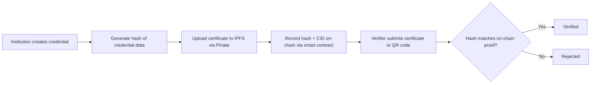

# BlockCert

**Blockchain-based academic credential issuance and verification, built as a frontend prototype.**


BlockCert explores how cryptographic hashing, blockchain, and decentralized storage can make academic credentials **tamper-evident**, instantly verifiable, and easy to share. It provides dedicated interfaces for three audiences: **institutions** that issue credentials, **students** who hold them, and **verifiers** who need to trust them.

> **Prototype status:** The current codebase is a frontend prototype. Authentication, wallet connection, blockchain calls, IPFS storage, and verification are **simulated or handled client-side**. Live integrations are required before BlockCert can be used for real credential verification.

---

## Table of Contents

- [The Problem](#the-problem)
- [How It Works](#how-it-works)
- [Features](#features)
- [Pages](#pages)
- [Technology Stack](#technology-stack)
- [Getting Started](#getting-started)
- [Project Structure](#project-structure)
- [Current Limitations](#current-limitations)
- [Contributing](#contributing)
- [License](#license)

---

## The Problem

Verifying an academic certificate usually means contacting the issuing institution by hand. That process is slow, hard to scale, and open to forged or altered documents. BlockCert demonstrates an alternative: the issuer records a cryptographic proof of each credential, and anyone can check a certificate against that proof without relying on manual back-and-forth.

## How It Works



1. **Credential issuance:** An authorized institution creates an academic credential.
2. **Cryptographic hashing:** A hash is generated from the credential data so any later change can be detected.
3. **Decentralized storage:** The certificate document can be stored on IPFS and referenced by its Content Identifier (CID).
4. **Blockchain registration:** A smart contract records the credential proof on-chain.
5. **Credential verification:** A verifier compares the credential against its recorded proof to confirm the data matches.

> **Important:** A hash proves that data has *not changed*, not that it is *authentic*. Trust also depends on confirming that the issuer is authorized and that the verification process itself is sound.

## Features

### Institution Portal
- Institution registration and login
- Dashboard with an overview of activity
- Certificate issuance form and result page
- Student, user, and credential record management

### Student Portal
- Student login and dashboard
- Personal credential records and detailed credential views

### Credential Verification
- Public verification page
- Hash generation workflow
- Credential lookup with verification status
- QR-based verification workflow

### User Interface
- Responsive layouts for desktop and mobile
- Separate, purpose-built interfaces for institutions, students, and verifiers
- Dashboard-style navigation
- Reusable styles and components

## Pages

| Page | Audience | Purpose |
|---|---|---|
| `index.html` | Everyone | Landing page |
| `institution.html` | Institutions | Institution portal entry |
| `institution-register.html` | Institutions | Register a new institution |
| `institution-login.html` | Institutions | Sign in |
| `institution-dashboard.html` | Institutions | Dashboard overview |
| `institution-issue.html` | Institutions | Issue a new certificate |
| `institution-issue-result.html` | Institutions | Issuance outcome and proof details |
| `institution-records.html` | Institutions | Browse issued credential records |
| `institution-students.html` | Institutions | Manage students |
| `institution-users.html` | Institutions | Manage institution users |
| `student-login.html` | Students | Sign in |
| `student-dashboard.html` | Students | View personal credentials |
| `verification.html` | Verifiers | Verify a certificate |

## Technology Stack

### Current prototype (frontend)

| Technology | Purpose |
|---|---|
| HTML5 | Page structure |
| CSS3 | Styling and responsive layouts |
| JavaScript | Client-side logic and interactions |
| Tailwind CSS | Utility-based styling |
| SVG | Icons and visual elements |

### Planned integrations

These are the project's intended stack and are **not yet connected to live services**.

| Layer | Technology | Purpose |
|---|---|---|
| Blockchain | Solidity | Smart contract development |
| Blockchain | ethers.js | Blockchain interaction |
| Blockchain | MetaMask | Wallet integration |
| Blockchain | Polygon Amoy | Target test network |
| Backend | Python + FastAPI | REST API |
| Backend | PostgreSQL | Persistent data storage |
| Storage | IPFS + Pinata | Decentralized file storage and pinning |

## Getting Started

BlockCert is a static site, so no build step is required.

**1. Clone the repository**

```bash
git clone https://github.com/satyamk550/Blockcert.git
cd Blockcert
```

**2. Serve the files locally**

Opening `index.html` directly can work, but a local server avoids issues with scripts and modules:

```bash
# Python
python -m http.server 8000

# or Node.js
npx serve .
```

**3. Open the app**

Visit `http://localhost:8000` in your browser.

> Because integrations are simulated, you can explore every portal without a wallet, backend, or API keys.

## Project Structure

```text
Blockcert/
├── assets/                    # Images and static assets
├── config/                    # Blockchain configuration
├── css/
│   └── styles.css             # Shared styles
├── js/
│   ├── app.js                 # Application entry logic
│   ├── main.js                # Shared page behavior
│   ├── modules/
│   │   ├── certificate.js     # Certificate creation and hashing
│   │   ├── contract.js        # Smart contract interaction
│   │   ├── ipfs.js            # IPFS / Pinata storage
│   │   └── wallet.js          # MetaMask wallet connection
│   ├── pages/                 # Page-specific scripts
│   └── utils/                 # Helper functions
├── src/
│   └── services/              # Service layer for future backend integration
├── index.html
├── institution*.html          # Institution portal pages
├── student-*.html             # Student portal pages
└── verification.html          # Public verification page
```

## Current Limitations

- Authentication is simulated and not secure.
- No live smart contract is deployed; blockchain calls are mocked.
- IPFS uploads and CID retrieval are not connected to Pinata.
- There is no backend or database, so data does not persist across sessions or devices.
- Issuer authorization (who is allowed to issue credentials) is not enforced.

## Contributing

Contributions, ideas, and feedback are welcome.

1. Fork the repository
2. Create a feature branch: `git checkout -b feature/your-feature`
3. Commit your changes: `git commit -m "Add your feature"`
4. Push the branch: `git push origin feature/your-feature`
5. Open a pull request

## License

This project is licensed under the [MIT License](LICENSE).
